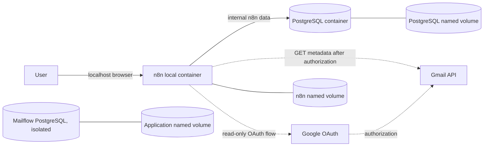
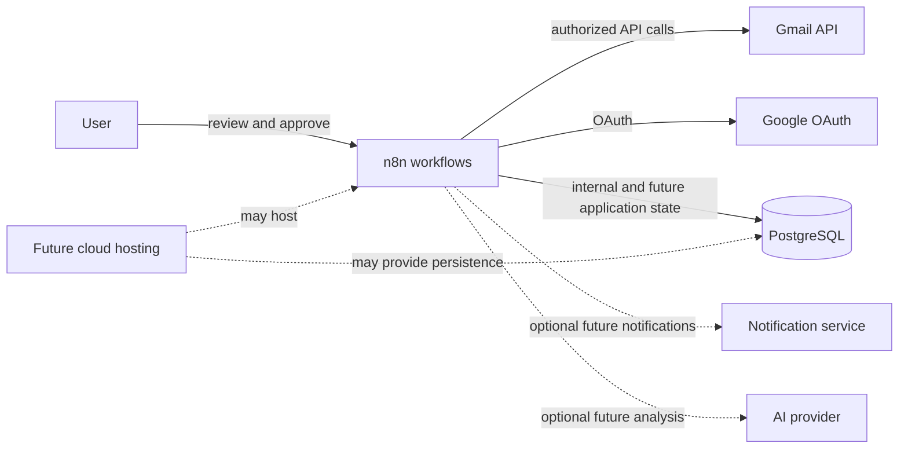
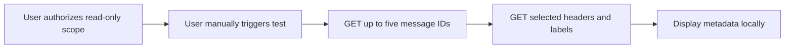
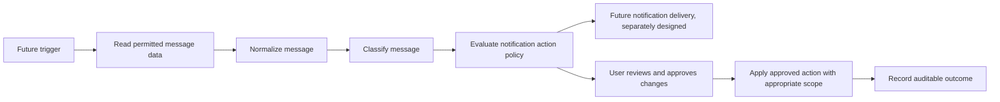
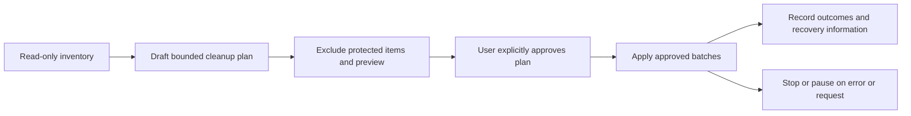

# Architecture

## Current implementation and status

The committed Phase 1A foundation runs n8n 2.47.4 and PostgreSQL 17.11
in Docker Compose. n8n uses PostgreSQL for its internal data; each service
has a named volume. The Phase 1B [connectivity workflow](../workflows/01-gmail-connectivity.json)
and [Gmail guide](gmail-read-only.md) are provided for manual setup.
Historical notes report a local manual read-only test returning five messages
on November 12, 2026; automatic token refresh remains unverified. The
definition is not automatically imported or bound to credentials.
The [bounded inventory](gmail-inventory.md) is a legacy reference. The
[item-state inventory](gmail-paginated-inventory.md#item-state-export-under-review)
was validated against a local synthetic mock, not live Gmail.

The standalone [normalizer](gmail-normalization.md),
[classifier](email-classification.md), and
[notification action policy](notification-policy.md) run offline. An inactive
[synthetic pipeline](synthetic-pipeline.md) demonstrates their composition in
n8n; it is not connected to Gmail and does not deliver notifications.
An inactive [live Gmail candidate](live-gmail-processing.md) connects the
same pipeline to bounded read-only Gmail requests and has been run twice
against live Gmail with separate approval. The repository export is unbound.
The [persistence foundation](postgres-persistence.md) includes a separate
local application database, migrated and verified with synthetic data, and an
independent transactional adapter.
A separate inactive [Gmail persistence candidate](live-persistence.md) has
been verified in the n8n runner with synthetic data and a separately approved
live run. Further live runs require separate approval.

### Current system context

Solid arrows are configured local relationships. Dashed arrows show the
in-progress, manually configured Gmail connection.

Google Cloud is used to register the OAuth application and enable Gmail API,
not to host the current application. n8n binds only to `127.0.0.1:5678`;
PostgreSQL has no published host port. Both use a private Compose bridge
network, which still permits outbound access. n8n waits for PostgreSQL health
and exposes a database readiness health check. HTTP and non-secure cookies
are suitable only for this local development setup; do not expose it through
a public tunnel, proxy, or webhook.

### Planned target context

Everything marked future or optional below is a design direction, not a
deployed component.

## Components and responsibilities

| Component | Current role | Future possibilities |
| --- | --- | --- |
| n8n | Local workflow editor and orchestration. The proposed manual workflow uses Gmail GET requests. | Scheduling, routing, batching, error handling, and integrations, once workflows implement them. |
| PostgreSQL | Persists n8n's internal data. A separate local application cluster contains the migrated schema and synthetic test data. | Approved integration, application state, rules, preferences, recommendations and audit history. |
| Google Cloud | Project registration, Gmail API enablement, OAuth client and consent configuration, including requested scopes. | Hosting is optional and separate from API registration. |
| Docker Compose | Pinned local containers, lifecycle, service network, health checks, and named volumes. | Local development remains useful even if an independently designed cloud deployment is added. |

The JSON files in [config](../config/) are empty placeholders, not loaded
classification rules. Application migration 1 was applied only to the
separate local application database, never to n8n's database.

## Data flows

### Read-only Gmail sample: in progress

The workflow requests no message bodies or attachments, uses no Gmail write
operations, and contains a second five-item cap. Its intended use and
limitations are in [Gmail setup](gmail-read-only.md). Bounded and paginated
inventory exports are present; full-mailbox persistence and resumption remain
unimplemented. Older versions are references, not approved for execution.

### Incoming classification and policy: future workflow

Normalization, classification, and policy evaluation exist as standalone
offline modules and are integrated in a manually triggered synthetic test
workflow. A manual read-only real-mail candidate has been tested twice against
Gmail; automated triggers, notification delivery, approval, and action
components remain future work. Optional AI could assist
recommendations after deterministic rules.

### Historical cleanup: future

No cleanup, approval, stop, audit, or rollback mechanism is implemented.
See the [safety model](safety-rules.md) for requirements before implementing
them.

## Security architecture

- **OAuth and least privilege:** the intended Phase 1B credential requests
  only `gmail.readonly`. That scope can read message content and settings,
  even though this workflow requests metadata only. Modifying mail requires
  separately requested broader permission and explicit approval; read-only
  consent does not authorize changes.
- **Credentials and encryption:** enter OAuth secrets and tokens directly in
  n8n, never Git. n8n stores credentials encrypted using the stable
  `N8N_ENCRYPTION_KEY`; protect and back it up separately. Losing it can make
  stored credentials unreadable.
- **Environment and volumes:** `.env` supplies the database password and key,
  is Git-ignored, and should be owner-readable only. Docker administrators
  can inspect container environment variables; this is not a secret vault.
  PostgreSQL and n8n named volumes persist sensitive state outside Git.
- **GitHub:** keep secrets, local databases, execution data, and email metadata
  out of exports, commits, issues, and logs. Ignore rules are not exhaustive;
  review staged content before pushing, even to a private repository.
- **Data minimization:** the test limits results to five and requests selected
  headers and labels. Execution output is private. Historical notes report
  that an imported workflow retained execution data before its save settings
  were adjusted. Post-change retention was not live-tested, and historical
  records or transient copies may remain; see the
  [retention review](gmail-read-only.md#execution-retention-review).
- **Recovery and audit:** secure backups of both service data and the key are
  necessary; no backup/restore procedure or application audit trail is
  implemented. Future mutating actions require tested recovery, explicit
  approval, and auditable outcomes.

## Decisions and tradeoffs

- **n8n instead of custom orchestration:** visual workflows and existing
  integrations accelerate development, but require careful versioning,
  credential management, and execution-data controls.
- **PostgreSQL:** durable relational storage supports n8n and potential
  structured application data, at the cost of operating and backing up a
  separate service. Future tables must be designed and migrated explicitly.
- **Docker Compose:** reproducible local services and isolated networking
  reduce setup effort, but do not by themselves provide hardened hosting,
  backups, monitoring, or high availability.
- **Gmail API instead of browser scraping:** documented OAuth and API access
  allow explicit scopes and structured requests, at the cost of API quotas,
  Google Cloud configuration, and OAuth lifecycle management.
- **Approval before high-impact changes:** reduces accidental harm but adds
  review effort; actual approval gates must be implemented and tested.
- **Rules first, optional AI later:** deterministic rules are easier to
  explain and test. Models may assist with uncertain cases, but add privacy,
  cost, and reliability risks and must not override explicit protections.
- **Local versus cloud:** local hosting provides direct control but depends
  on an available machine and local backups. Cloud hosting may improve
  availability but introduces recurring cost, security, persistence,
  background-worker, and operational responsibilities. See
  [extensibility](extensibility.md).
